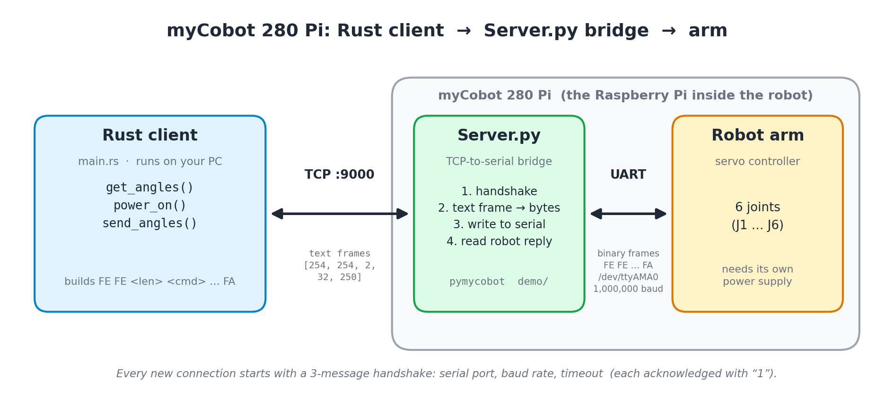

# myCobot 280 Pi: Rust client

A small, dependency-free Rust program (`main.rs`, std only) that controls a
**myCobot 280 Pi** over the network. It reads the joint angles, powers on the
servos, and nudges the shoulder (joint 2) a few degrees toward vertical.

It does not talk to the robot directly. It talks to a **TCP-to-serial bridge**,
`Server.py`, which runs on the Raspberry Pi inside the robot.

## How it fits together



- **Robot side.** The myCobot 280 Pi has a Raspberry Pi built in. Its serial port
  (`/dev/ttyAMA0`, 1,000,000 baud) is wired to the arm's servo controller.
- **`Server.py`** comes from the `demo/` folder of the
  [pymycobot](https://github.com/elephantrobotics/pymycobot) repository. It runs on
  the Pi, opens a plain TCP socket on port 9000, and forwards whatever it receives
  to the serial port. It reads the robot's answer and sends it back. It is not an
  HTTP server, so a browser or `curl` won't work with it.
- **This client** runs on any machine that can reach the Pi. It builds the robot's
  binary command frames and sends them through the bridge.

## Prerequisites

1. The robot is powered on (its own power supply connected, not just USB or serial)
   and the arm has clear space around it.
2. On the Pi, `Server.py` is running:

   ```bash
   cd ~/pymycobot/demo
   python Server.py
   ```

   You should see:

   ```
   ip: 192.168.x.x port: 9000
   Binding succeeded!
   waiting connect!------------------
   ```

   If it fails with `PermissionError` on `server.log`, the file is probably owned by
   root from an earlier `sudo` run. Delete it (`rm -f server.log`) and start again.
   Serial and GPIO access may also need your user in the `dialout` and `gpio` groups.
3. The Rust toolchain is installed on your PC (<https://rustup.rs>).

## Running

```bash
cargo new cobot-rs && cd cobot-rs
# replace src/main.rs with main.rs from this folder
cargo run
```

Set `ADDR` at the top of `main.rs` to the Pi's IP and port. Expected output:

```
start: [57.74, 87.8, 57.12, 18.1, 60.38, 32.16]
end:   [57.73, 82.79, 57.12, 18.1, 60.38, 32.15]
```

Your numbers will differ. Joint 2 in `end:` should be about 5° closer to 0 than in
`start:`.

## What the code does

| Piece | Purpose |
|---|---|
| `frame(cmd, data)` | Builds a myCobot frame: `FE FE <len> <cmd> <data…> FA`. `len` is the data length plus 2. |
| `Cobot::connect` | Opens the TCP connection and does the 3-message handshake (see below). |
| `Cobot::request` | Sends one command frame and returns the server's single reply. |
| `Cobot::get_angles` | Command `0x20`. Returns the 6 joint angles in degrees. |
| `Cobot::power_on` | Command `0x10`. Powers on the servos so they hold position and accept moves. |
| `Cobot::send_angles` | Command `0x22`. Sends 6 target angles and a speed (0-100). |
| `main` | Reads the angles, powers on, moves joint 2 by 5° toward vertical at speed 20, waits 2 s, reads the angles again. |

### Protocol details

- **Angles** are signed 16-bit big-endian integers in degrees × 100 (57.74° is `5774`).
- **Speed** is one byte, clamped to 0-100.
- **Joint 2** (the shoulder, index 1 in the array) is 0° with the upper arm vertical.
  The test move therefore subtracts `signum() × 5°` from it, which always moves toward
  the sky from either side.

### Quirks of this `Server.py` version

These came from reading the server code. Other versions of the demo file behave
differently, and an older one expects raw binary frames instead.

1. **Handshake first.** Each new connection must send three plain-text messages:
   the serial port (`/dev/ttyAMA0`), the baud rate (`1000000`) and a timeout (`0.1`).
   The server answers each with `1`, and after the third it opens the serial port.
   The server resets this per connection, so every client has to repeat the handshake.
   The client checks each acknowledgement.
2. **Frames are sent as text.** After the handshake, each command is the *text* of a
   list, for example `[254, 254, 2, 32, 250]`. The server parses it with a regex and
   converts it back to bytes. Rust's `{:?}` on a `Vec<u8>` prints exactly this format.
3. **One reply per request, and it may be late.** The server waits only about 50 ms for
   the robot, then replies with whatever bytes it has, or `1` if there are none. A
   robot answer can therefore show up in the *next* reply. `get_angles` retries up to
   5 times and searches for the reply header (`FE FE 0E 20`) instead of trusting the
   first bytes.
4. **Ignore replies to motion commands.** The answer to `power_on` or `send_angles` is
   usually just `1` or a stale frame. Check the result by reading the angles back.
5. **One client at a time.** The server handles connections one after another. Close
   the client before starting another.
6. **Minor server bug.** `timeout=float(port_baud[1])` uses the baud rate as the serial
   timeout. It is harmless here because `read()` never blocks.

## Safety

- Keep the arm's workspace clear and start with small angles and low speeds.
- `send_angles` takes absolute targets. Always start from the angles you just read,
  as `main` does, because sending zeros could swing the arm a long way.
- The shoulder carries the whole arm. Raise the 5° step gradually (10°, then 20°)
  rather than jumping to a large move.

## Troubleshooting

| Symptom | Likely cause |
|---|---|
| Handshake error, or the server replies `ERROR:'utf-8' codec can't decode…` | The server expects the text format, but raw binary was sent. Use this client. |
| Server reply is a single `1` and no angles | The handshake was skipped, so the frame was taken as a setup message. |
| `get_angles` times out | The server is fine but the robot isn't answering. Check power, wiring, baud rate and that the serial console is disabled in `raspi-config`. |
| Angles OK but the arm doesn't move | Servos aren't powered on, or the arm lacks its own power supply. |
| Joint 2 moves away from the sky | Sign convention differs on your unit. Change `-=` to `+=` in `main`. |
| Connection refused or timeout | `Server.py` isn't running, or the IP or port is wrong. |

## Extending it

To add more commands (coordinates, grippers, LEDs), copy the command ID and data
layout from pymycobot's source (`ProtocolCode` and the relevant method in
`mycobot.py`). Then send them with `request(cmd, &data)`.

The official Python client is `pymycobot.MyCobotSocket`. It speaks the same
handshake and text-frame protocol, so it's a good cross-check if something looks off.
